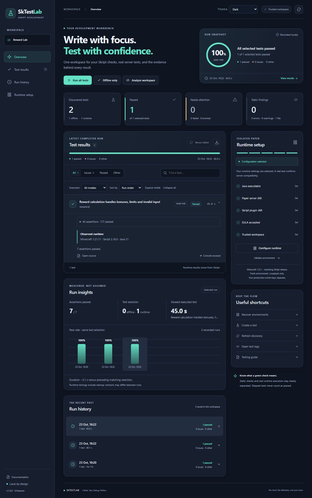

# SkTestLab — Skript Testing & Diagnostics

**DHeaven · Write. Test. Debug. Perfect.**

[Source](https://github.com/Alexpetkanov13/SkTestLab) · [Downloads](https://github.com/Alexpetkanov13/SkTestLab/releases) · [Issues and support](https://github.com/Alexpetkanov13/SkTestLab/issues) · [MIT license](LICENSE.txt)

Skript diagnostics and repeatable tests in VS Code's native Testing sidebar. No account or cloud service required; coexists with your syntax-highlighting extension.

Initial supported platform: **Windows x64**, VS Code 1.96+. The release VSIX targets `win32-x64`. Linux, macOS and Windows ARM64 are not release-certified; source is available under MIT for testing and contributions.

Dashboard **Theme** menu: choose **White**, **Dark**, or **Follow VS Code**. Your choice is remembered locally without changing the editor theme.

## Available in 1.0.1

- Source-preserving analysis with 12 configurable diagnostic rules, confidence labels, two Quick Fixes and cross-file declaration warnings.
- Versioned `.sktest.json` definitions, JSON Schema and snippets.
- Native Test Explorer: hierarchy, tags, selected and related-file runs, failed/last-selection reruns, cancellation and assertion diffs.
- Deterministic offline diagnostic, source, symbol and structure assertions.
- Optional isolated Paper provider: selected JARs, loopback-bound worlds, generated Skript harness, correlated results and ownership-checked cleanup.
- An interactive mint-accented dashboard with comparable run trends, slowest-test insights, mode filters, sorting and complete assertion evidence: live progress, searchable/filterable results, assertion details, source links, workspace-scoped history, runtime setup checklist and direct testing actions.
- SkTestLab activity-bar view, offline-only runs, live status bar, declaration-based templates, CodeLens, regression comparison, JSON/HTML/JUnit reports and offline CLI.

**Status: 1.0.1 · Windows x64.** Real Paper 1.21.11-132 / Skript 2.16.0 / Java 21.0.12 tests verify passing/failing assertions, parse errors, warning-only scripts and startup cancellation. ChickFarm project checks exposed and fixed static false positives and multiline runtime error handling. Paper Minecraft 1.21+ and upstream-compatible Skript releases are accepted without a version whitelist. Observed versions are retained with results. Verified runtime coverage spans Skript minor lines **2.9–2.17** on compatible Paper versions (including 2.17.1). See the [exact compatibility matrix](docs/compatibility.md); this does not certify every patch or addon. See [verification](docs/verification.md), [ChickFarm results](docs/chickfarm-verification.md) and [limitations](docs/roadmap.md).



[View the White theme](docs/images/dashboard-white.png). Screenshots show the final recorded Reward Lab runtime matrix.

## Install and use

1. Extensions → … → Install from VSIX, or run the command below.
2. Open a project folder and `.sk` file. Run **SkTestLab: Analyze Current File**.
3. Run **SkTestLab: Create Test** → **Structure regression**. Review expectations: they capture current findings rather than proving behavior correct.
4. Open Testing (beaker) and run. Use **SkTestLab: Open Dashboard** for saved results.

```powershell
code --install-extension ./sktestlab-win32-x64-1.0.1.vsix
```

Minimal offline test; paths are relative to the owning workspace folder:

```json
{
  "schemaVersion": 1,
  "id": "reward-declared",
  "name": "Reward is declared",
  "mode": "offline",
  "targets": ["script.sk"],
  "assertions": [
    { "kind": "symbol", "operator": "contains", "expected": "reward" },
    { "kind": "diagnostic", "operator": "size", "expected": 0 }
  ]
}
```

Offline success confirms only these structural expectations. Unknown addon expressions remain unvalidated. Minecraft behavior requires runtime testing.

## Optional runtime

**Configure Runtime** selects Paper/Skript JARs and Java. Review and explicitly accept the Minecraft EULA. Use `timeoutMs: 300000` for cold startup. Tests use owned temporary directories, never your production server. See [runtime guide](docs/runtime-testing.md).

## Build and verify

Development requires Node.js 24 LTS and npm. Offline extension usage needs neither a separate Node installation nor Java.

```sh
npm ci
npm run format:check
npm run lint
npm run check
npm test
npm run test:integration
npm run package
node dist/cli.js examples/beginner/script.sktest.json --junit=results.xml
```

Extension-host tests download clean VS Code; Linux CI uses Xvfb. Normal CI does not start Minecraft.

## Documentation

[Getting started](docs/getting-started.md) · [Testing](docs/testing-guide.md) · [Configuration](docs/configuration.md) · [Runtime](docs/runtime-testing.md) · [Diagnostics](docs/diagnostics.md) · [Architecture](docs/architecture.md) · [Troubleshooting](docs/troubleshooting.md) · [Verification](docs/verification.md) · [Roadmap](docs/roadmap.md)

No debugger, execution coverage or telemetry. Publisher `dheaven` requires owner registration. License selection remains the owner's decision; review LICENSE.txt before distribution.
